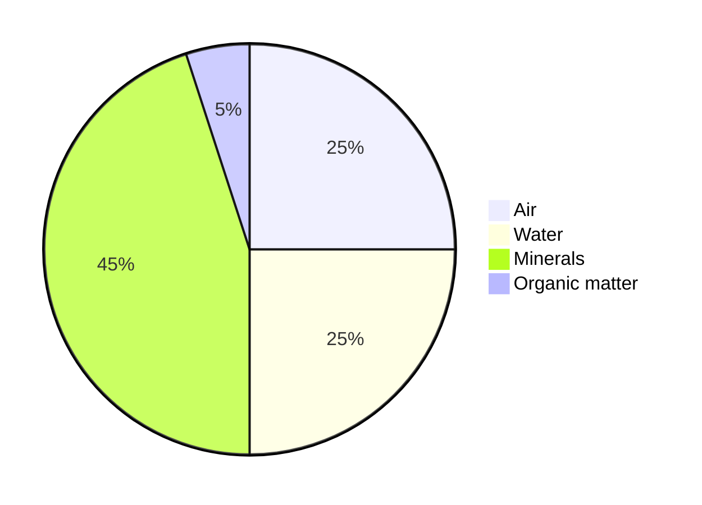

## Terms

Microorganism, _microbe_  
: An [organism][1] of [microscopic][2] size, which may exist in its
[single-celled][3] form or as a [colony of cells][4].  
: In the context of soil science our main concerns are with first with
**bacteria**, **fungi**, and then perhaps **protozoa**, **viruses**, and
**algae**; the last group is **archaea**, more common in odd environments like
hot springs or salty lakes.

Soil  
: A living ecosystem of mineral "dirt", air, water, and both living or dead
decaying organic matter.

Dirt  
: The inert, lifeless aggregate of various crushed minerals that includes sand,
silt, and clay.

[1]: https://en.wikipedia.org/wiki/Organism
[2]: https://en.wikipedia.org/wiki/Microscopic_scale
[3]: https://en.wikipedia.org/wiki/Unicellular_organism
[4]: https://en.wikipedia.org/wiki/Colony_(biology)#Microbial_colonies

## Soil ecosystem

### Microorganism volume

- There are around 1,000,000,000 microorganisms per gram of soil.
- More microbes in a teaspoon of soil than there are people on Earth.
  - I came across this [fun aside][fun] while double checking my notes

### Other soil life

Each step is successively larger, some feeding on decaying matter and others
predating on organisms within their own or smaller scales.

- **microfauna:** e.g., protozoans, tardigrades, and nematodes.
- **mesofauna:** e.g., mites, springtails, coneheads
- **macrofauna:** e.g., earthworms, ants, beetles, &c
- **megafauna:** e.g., moles, gophers, lizards, an ant _colony_

[fun]: [[Soil Science microbe quote hole]]

## Soil material

### Soil composition

By volume, the composition of soil has a 1 : 5 : 5 : 9 ratio of organic mater to
water, air, and minerals.

Laura called it something like an "indoor water park", because it's like the
minerals form a structure of microscopic caverns filled with air and water that
the organic matter and microbes are playing around in.

### Particle makeup

The mineral content of soil is dirt: lifeless, inert aggregate composed of many
different minerals and classified by particulate size moreso than elemental
makeup. Dirt of any kind is smaller than _gravel_.

#### Sand

Roundish, macroscopic mineral particle — larger than silt and the only soil
particle visible without a microscope. It is coarse and drains water very
quickly. Extremely sandy soil will not hold water sufficiently and is unsuitable
for most plant species.

Some people use sand as a soil additive to improve drainage, but Laura generally
recommends against it.

> [!question]  
> Why does Laura recommend against? I don't recall.

#### Silt

Round, microscopic mineral particle — smaller than sand and larger than clay.

How big is that? depends who you ask…

<table>
  <tr>
    <th>USDA</th>
	<td>United States Department of Agriculture</td>
    <td>0.05–0.002 mm</td>
  </tr>
  <tr>
    <th>ISSS</th>
	<td>International Society of Soil Science</td>
    <td>0.02–0.002 mm</td>
  </tr>
</table>

Many have heard of silt in the context of river deltas and floodplains, where
deposits of sediment picked up by a river as it erodes its surroundings have
created fertile soil.

Silt is desirable, occupying the happy medium of water retention vs drainage.

### Clay

The smallest soil mineral particle — distinct in _shape_ as **thin, flexible**
**plates**.

Clay plates tend to stick to one other:

- when moist, they slip around as the moldable, plastic matrix we often think of
  as clay in the artistic sense;
- when dry, the plates form weak bonds that make it solid yet fragile and easily
  crubled;
- when **burnt**, as in a kiln, the weak bond of dry clay undergoes a reaction
  to become a _molecular_ bond, wherein the plates are essentially _fused_
  together to form **ceramic**.

Clay can be useful in soil, it hold a _lot_ of moisture; _too much clay_, on the
other hand, is detrimental in that it is too _hard_ and _dense_ for plants to
grow through, or so slow draining as to promote rot.

## On tillage

### Why you shouldn't

### But why sometimes you should

## Soil ammendments

### …as chemicals

### …from natural sources

- Manure
- Compost
- Bio-char

### Nitrogen burn

##### …as it relates to manure

## Cover cropping

### Why cover crop

### When to cover crop

### Example crops

## Bio-char

## References

Teaming with Microbes

Illain Ingham
