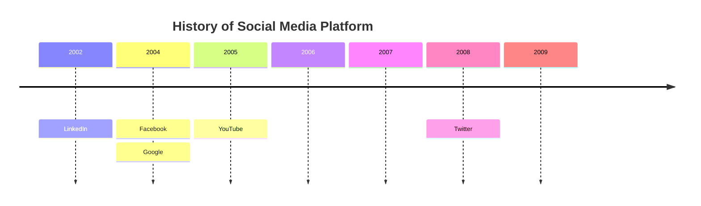
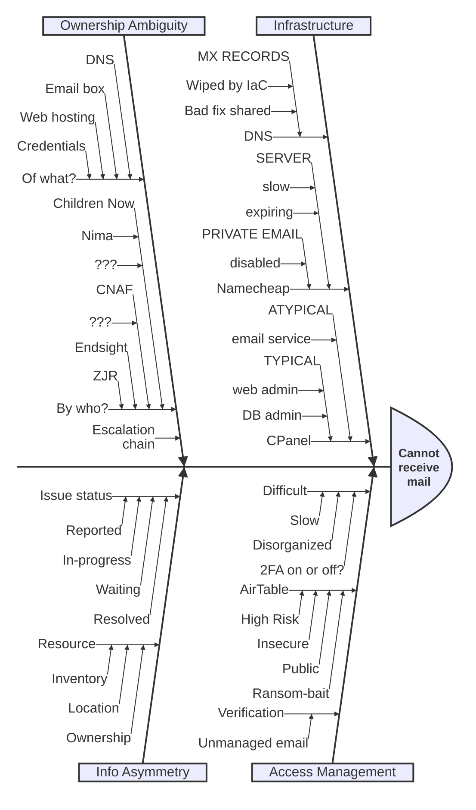

# old email draft

## Subject
CNAF, Emails, Endsight
## Intro

Here is a sort of “post-mortem” analysis of the email fiasco, along with some thoughts on what’s next.

But first, I should have made a greater effort to ensure there wasn’t anything to lose on the cPanel during the move, and I’m sorry for that.
## Assumptions
Now, some background assumptions…

1. The Namecheap server was set to expire at the end of September had you not done anything (and you only did because this email issue popped up).
2. You were not using Namecheap’s “Private Email” service at any time shortly before, during, and after the move.
3.   

## Analysis
…and analysis…

1. It had been my _intent_ to preserve the DNS records.

2. This would have forestalled the issue, _but only temporarily_ since the Namecheap server would have expired and shut down.
3. I tried to preserve the records as a “just-in-case”, but did not actually anticipate they would be used.

4. The old DNS records were wiped by an automation during the move but it escaped my notice, otherwise I’d have restored them.

5. But again, without realizing the email server was hosted on Namecheap we would have had the same failure on October 1.

6. Though I meant to remove my 2FA from your Namecheap account within a month or so, I had been keeping it enabled so that I wouldn’t be locked out if something went wrong, and the Namecheap interface made it unclear whether that would be the case after disabling.

7. It was quite difficult accessing the account without it!
8. I reference an improvement to this under the recommendations list, item #1.

## Recommendations
…and finally, my recommendations to increase systemic resilience (from an IT/cybersecurity/operational standpoint, at least) for Children Now & CNAF going forward… 

1. CN & CNAF really MUST have better processes in place for identity management.

2. You currently have a big list of accounts with plain text usernames & passwords stored in public AirTable (at least, you did a month ago because I used it to find CNAF's Namecheap credentials).

3. This is **VERY BAD**! I cannot stress enough how dangerous this is. It is only a matter of time before some bot randomly lands on this page, scrapes up all your credentials, passes them on to a hacker group or two, who will then fully infiltrate every account in that list, lock you out of them, and send you a ransom — and there won’t be much if anything you can do about it. They would likely use their access to make lateral and upwards moves as well, gaining access to systems in _addition_ to what’s in the list.

4. I highly recommend CN & CNAF purchase some form of credential management software, _as soon as possible_.

5. NOT LastPass — they just aren’t very good at it and have been hacked more than once.
6. I have used 1Password for several years and like it.
7. I use KeePassXC at work, the benefit is that it’s free, but I think you’ll find it harder to use.
8. There are others, I can help with selection if you want, but I also think you can manage it yourself.
9. I recommend you spend money on this because whatever you spend will be a lot cheaper than paying a ransom and it will help you to avoid situations like the one we just had by making access to critical accounts and infrastructure streamlined.

# Timeline

# Ishikawa

